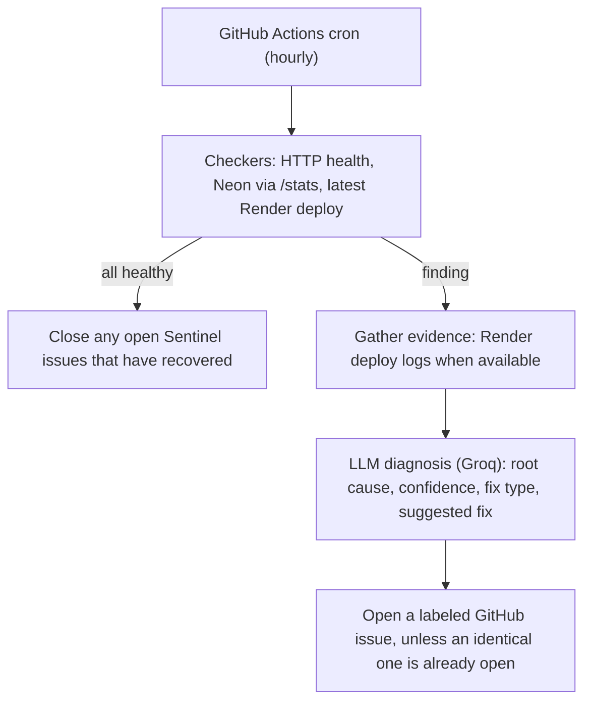

# Sentinel: an autonomous reliability agent for small ML deployments

Sentinel watches my live projects, works out what went wrong when one breaks, and files a GitHub issue with a diagnosis. When the problem goes away, it closes the issue itself. It runs hourly on GitHub Actions with no server, no database and no dashboard.

I built it after a long deployment session where I hit the same failure types again and again: dependency conflicts, slow package downloads, cold-starting free-tier hosts. Most of the time was spent noticing something was down and then reading logs. Sentinel automates those two steps.

## What it watches

| Target | How |
|---|---|
| PD-Voice-Screening API (Render) | HTTP check on `/health`, plus the status of the latest Render deploy |
| Neon database | HTTP check on the API's `/stats` endpoint, which queries the database, so a healthy response proves Render, the API code and Neon all work |
| Streamlit apps (PD-Voice-Screening UI, MedRAG) | HTTP check |

## How it works



Each diagnosis records how much evidence it was based on. `evidence: logs` means the model read real deploy logs. `evidence: metadata_only` means it only had a status code, and it says so, with low confidence, instead of guessing.

## Design decisions

- **The LLM only recommends.** The model never decides what the agent is allowed to do. Allowed actions are fixed in code.
- **The only write action is a GitHub issue.** Sentinel opens, comments on and closes issues carrying the `sentinel` label. It never touches code, deployments or configuration.
- **Dry-run is the default.** Nothing reaches GitHub unless `SENTINEL_DRY_RUN=false`. The workflow sets that explicitly, so local runs can never file a public issue by accident.
- **No duplicate issues.** An open issue for the same target and failure type is not re-filed.
- **Auto-close is conservative.** Issues are closed only when every check ran successfully. A check that could not run proves nothing about health, so nothing is closed.
- **Error text is sanitized before publishing.** Raw exceptions can contain request URLs and identifiers, so only a status code or error type goes into an issue. I added this after a real run showed why it matters.
- **Generous timeouts.** Free-tier hosts sleep when idle, so checks wait up to 60 seconds with one retry before calling something down.

## What I verified

- **Diagnosis quality.** I replayed a real failure from my own deployment history (a `protobuf` version conflict that broke a Streamlit build) through the diagnosis step with `python main.py --demo`. It identified the conflicting pin correctly, with high confidence and cited evidence.
- **The full loop, in testing.** I pointed a check at a URL that returns 404. Sentinel detected it, diagnosed it with low confidence and metadata-only evidence, opened [issue #3](https://github.com/Baffxy/PD-Voice-Screening/issues/3), declined to open a duplicate on the next run, and closed the issue itself once I restored the URL.
- **A real fault, in production.** The first scheduled-style run on GitHub Actions reported a Render API 404, because I had pasted a wrong value into a repository secret. Sentinel diagnosed it as an invalid service ID, which was correct, opened [issue #4](https://github.com/Baffxy/PD-Voice-Screening/issues/4), and closed it after I fixed the secret.

## Limitations

- **The model's suggested fix can be wrong.** In the replay above, the root cause was right, but the suggested fix (pin `protobuf` below 6) would have swapped one conflict for another, because another package in the same log required `protobuf>=6.33.5`. This is why Sentinel files issues and does not open pull requests. An unreviewed automated code change is riskier than a well-evidenced issue.
- **Streamlit Community Cloud exposes no log API.** For those apps Sentinel can detect that something is down but can only diagnose from metadata.
- **A passing HTTP check is not a full health check.** It shows a page responds, not that every feature works.
- **GitHub schedules are best-effort.** Runs can start late or be skipped under load. In my deployment the first scheduled run took several hours to appear. GitHub also disables scheduled workflows in public repos after 60 days with no repository activity, so this needs an occasional commit or a manual re-enable.
- **Deduplication is by title.** If a failure's cause changes while its issue is open, the issue is not updated.
- **Token expiry.** The fine-grained GitHub token expires on the date chosen when it was created, after which runs fail at the GitHub step.
- **Targets are hard-coded** in `config.py` for my own projects. Adapting it to yours means editing that file.

## Setup

```bash
git clone https://github.com/Baffxy/sentinel-agent.git
cd sentinel-agent
python -m venv venv
source venv/Scripts/activate      # or venv/bin/activate on Mac/Linux
pip install -r requirements.txt
```

Copy `.env.example` to `.env` and fill in:

| Variable | Purpose |
|---|---|
| `RENDER_API_KEY`, `RENDER_SERVICE_ID` | Read deploy status and logs from Render |
| `GROQ_API_KEY` | Diagnosis (free tier is enough) |
| `GITHUB_TOKEN` | Fine-grained token with **Issues: Read and write** on the monitored repos only |
| `SENTINEL_DRY_RUN` | `true` (default) prints what it would do; `false` acts on GitHub |

Try it safely:

```bash
python main.py --demo    # replay a past incident through diagnosis, never touches GitHub
python main.py           # real checks; dry-run unless SENTINEL_DRY_RUN=false
```

To run it on a schedule, push the repo and add four repository secrets: `RENDER_API_KEY`, `RENDER_SERVICE_ID`, `GROQ_API_KEY`, and `SENTINEL_GITHUB_TOKEN` (GitHub does not allow secret names starting with `GITHUB_`, so the workflow maps it to `GITHUB_TOKEN`). The workflow in `.github/workflows/sentinel.yml` does the rest.

## Possible extensions

- Open a **draft** pull request for a narrow allow-list of known-safe fix types, only after a CI check passes and always behind human review
- Update an open issue when a new run's diagnosis differs from the original
- An independent trigger (such as an external cron service calling `workflow_dispatch`) for tighter detection timing than GitHub's schedule gives

## Stack

Python · GitHub Actions · GitHub REST API (PyGithub) · Render API · Groq (LLM diagnosis)